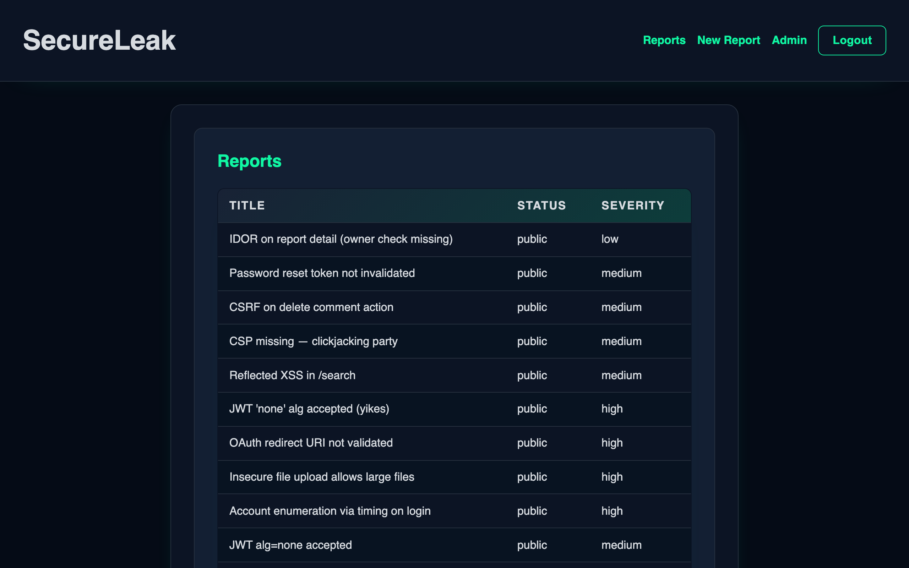
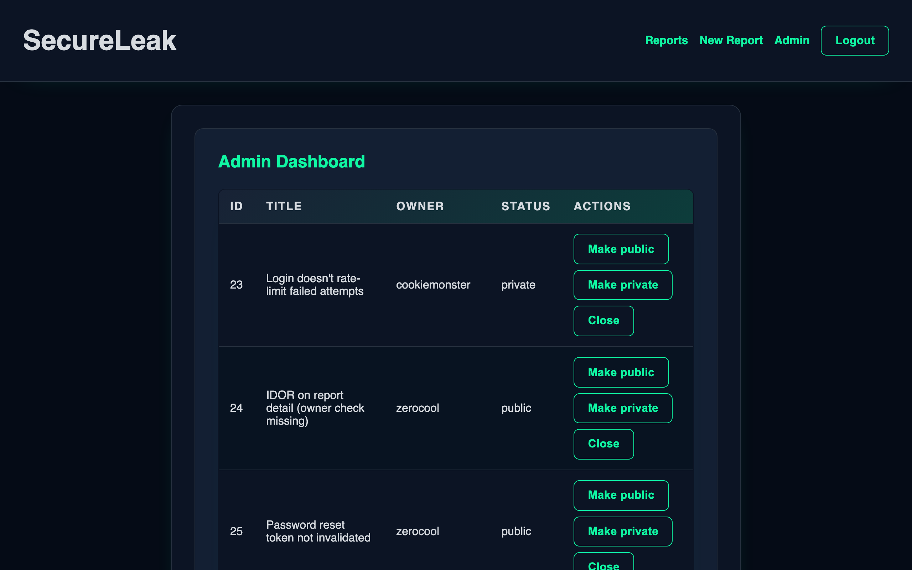

# SecureLeak

A small Flask tracker where users submit vulnerability reports and admins review them. I built it as a student project for the course Security in Web Development (IT Architecture, 5th semester, 2025), and it is protected against the same threats it is about. The focus is server-side authorization, CSRF and XSS defences, password hashing, upload sanitization and rate limiting.

Python, Flask, Jinja2, SQLite (raw parameterized SQL, no ORM), pytest.


[](https://github.com/marcus-rk/SecureLeak/actions/workflows/ci.yml)
[](LICENSE)

It is intentionally **meta**: a secure app *about* vulnerabilities, protected against the threats it demonstrates. It is a controlled learning environment, not a product.

| Report list | Admin dashboard |
|:--|:--|
|  |  |

*Screenshots from a local run with seed data.*

---

## Core Security Focus

| Threat | Mitigation |
|:--------|:------------|
| SQL Injection | Parameterized queries in the repository layer only |
| XSS | Auto-escaped templates, CSP, HttpOnly cookies |
| CSRF | Flask-WTF CSRF tokens, SameSite=Lax |
| DoS / Abuse | Rate limiting (Flask-Limiter), 3 MB request size limit |
| File Upload Abuse | Extension allowlist, MIME check, Pillow re-encoding (strips metadata), random file names, storage outside `static/` |
| Non-repudiation | Audit logging (who, what, when, from where) |
| Brute Force | Login rate limit (5 per minute), Argon2id hashing, common-password check |
| Session Hijacking | HttpOnly + SameSite cookies, session cleared at login, 30-minute idle timeout |
| Client-Side Manipulation | All checks enforced server-side |

---

## Quickstart

Requires Python 3.11+. These commands create a demo database with seeded accounts and start the app in debug mode on `http://localhost:5000`. Replace `<your-seed-password>` with a password of your choice (at least 10 characters, not a common password).

```bash
git clone https://github.com/marcus-rk/SecureLeak.git && cd SecureLeak
python3 -m venv .venv && .venv/bin/pip install -r requirements-dev.txt
printf 'SECRET_KEY=%s\nSEED_PASSWORD=%s\n' "$(python3 -c 'import secrets; print(secrets.token_hex(32))')" '<your-seed-password>' >> .env
.venv/bin/python -m seed.seed_runner && .venv/bin/flask --app app run --debug
```

On macOS, AirPlay Receiver may already use port 5000; if the page does not load, add `--port 5001` to the last command and open `http://localhost:5001`.

Sign in as the seeded admin `admin1@mail.com` with your `SEED_PASSWORD` to see the admin dashboard. This is a local demo credential only; every seeded account shares that password.

---

## Documentation

- Project overview and full project structure: [docs/project_overview.md](docs/project_overview.md)
- Authentication and sessions: [docs/auth.md](docs/auth.md)
- Security model (threats and defences): [docs/security_model.md](docs/security_model.md)
- Input handling: [docs/input_handling.md](docs/input_handling.md)
- Reports and uploads: [docs/reports.md](docs/reports.md)
- Roles and admin area: [docs/roles.md](docs/roles.md)
- Rate limiting and DoS: [docs/limiting.md](docs/limiting.md)
- Audit logging: [docs/audit_logging.md](docs/audit_logging.md)
- Image sanitization: [docs/image_sanitization.md](docs/image_sanitization.md)
- Security.txt: [docs/security_txt.md](docs/security_txt.md)
- Exam highlights (code snippets and reflections): [docs/exam_highlights.md](docs/exam_highlights.md)
- Domain vocabulary and invariants: [CONTEXT.md](CONTEXT.md)
- Architecture decision records: [docs/adr/](docs/adr/)

---

## Design Decisions

Drawn from [docs/exam_highlights.md](docs/exam_highlights.md), where each one is explained in full:

- **Flask over Django, SSR over a client-side framework.** Flask made CSRF, security headers and the login decorator explicit configuration rather than framework defaults. Server-side rendering sends only what the user may see and keeps the session in an HttpOnly cookie instead of `localStorage`.
- **Defence in depth.** No single control is relied on: XSS meets auto-escaping and CSP, CSRF meets SameSite cookies and tokens, and admin access is checked in the session and then against the database on every request.
- **Argon2id with explicit parameters** (64 MiB memory cost) instead of bcrypt or PBKDF2, plus a check against the 10,000 most common passwords (NIST SP 800-63B) instead of complexity rules.
- **Sanitization by reconstruction.** Uploaded images are re-encoded with Pillow and stored under random names outside `static/`, so hidden content in a file that only looks like an image is not kept.
- **One visibility policy.** A single function decides whether a report is viewable, and the report page, comments and image route all use it. See [ADR 0002](docs/adr/0002-single-visibility-policy.md).

---

## Roles and Permissions

| Action | User | Admin |
|:--------|:-----------------|:------|
| Register / Login | ✅ | ✅ |
| Create report | ✅ | ✅ |
| Upload image | ✅ | ✅ |
| View **public** reports | ✅ | ✅ |
| View **private** reports | ⚠️ (only their own) | ✅ |
| View **closed** reports | ❌ | ✅ |
| Comment on reports | ⚠️ (only reports they can view) | ✅ |
| Change report status (Public / Private / Closed) | ❌ | ✅ |

Registration always creates a `user`; admins come only from seed data ([ADR 0005](docs/adr/0005-admin-role-not-self-assignable.md)).

## Key Features

- Registration and login (Argon2id)
- Role-based access (User / Admin)
- Create and view vulnerability reports
- Public / private report visibility
- Comments on reports
- Sanitized image uploads

---

## Installation

### Prerequisites
- Python 3.11+
- pip

### Steps

1. **Clone and set up**
   ```bash
   git clone https://github.com/marcus-rk/SecureLeak.git
   cd SecureLeak
   python3 -m venv .venv && .venv/bin/pip install -r requirements-dev.txt  # runtime + pytest and ruff; requirements.txt alone is runtime-only
   ```

2. **Set SECRET_KEY**
   `SECRET_KEY` signs sessions and CSRF tokens. Outside debug mode the app refuses to start when it is missing or empty.
   Add it to a `.env` file in the project root (created if missing) with a strong random value:
   ```bash
   printf '\nSECRET_KEY=%s\n' "$(python3 -c "import secrets; print(secrets.token_hex(32))")" >> .env
   ```
   *Note: In debug mode (`--debug`) the app falls back to an insecure development key if `SECRET_KEY` is not set. Never use debug mode outside local development.*

3. **Initialize the database**
   The database is automatically initialized on the first run.
   Optionally, you can seed it with demo data (the seed runner does not use debug mode, so it needs `SECRET_KEY` from step 2).
   All seeded accounts, including the admins `admin1@mail.com` and `admin2@mail.com`, share one password that you choose. There is no default. Add a line to `.env`, replacing the placeholder with your own password:
   ```
   SEED_PASSWORD=<your-seed-password>
   ```
   Then run:
   ```bash
   .venv/bin/python -m seed.seed_runner
   ```
   *Note: The seed runner refuses to run, and deletes nothing, if `SEED_PASSWORD` is missing or fails the registration rules (at least 10 characters, not on the common-password list).*

4. **Run the application**
   ```bash
   .venv/bin/flask --app app run --debug
   ```
   Access at: `http://localhost:5000`. On macOS, AirPlay Receiver may already use port 5000; add `--port 5001` and use `http://localhost:5001` instead.

### Environment Variables

Read by `create_app()` in `app.py`, from the environment or `.env`:

| Key | Purpose | Default |
|:----|:--------|:--------|
| `SECRET_KEY` | Signs session cookies and CSRF tokens | None. Required outside debug mode; debug mode falls back to an insecure development key |
| `DATABASE` | Path to the SQLite database file | `instance/secureleak.sqlite` |
| `UPLOADS_DIR` | Directory for uploaded images | `uploads` |

The seed runner also reads `SEED_PASSWORD` (no default, see step 3).

### Running with HTTPS (Local)
To test secure cookies and headers properly:
```bash
# Install mkcert
brew install mkcert nss
mkcert -install
mkcert localhost 127.0.0.1

# Run with certs
.venv/bin/flask --app app run --cert=localhost+1.pem --key=localhost+1-key.pem
```
Access at: `https://127.0.0.1:5000`

---

## Testing

```bash
# Run all tests with a pass/fail summary
.venv/bin/python -m pytest -o addopts="" -q

# Run one category
.venv/bin/python -m pytest -o addopts="" -q tests/auth/
```

**What the tests cover:**
- **Auth**: login with and without CSRF token, registration conflicts (taken email or username), session cookie lifetime and idle timeout.
- **Security**: security headers including a restrictive CSP, and the app refusing to start without `SECRET_KEY`. The older `tests/security/test_csp_headers.py` is skipped because `test_headers.py` replaced it.
- **Repository**: database CRUD operations (users, reports, comments).
- **Uploads**: public/private image access and rejection of a disallowed extension.
- **Seed**: the seed runner's password checks, and a seeded admin that can authenticate.

Report and admin access rules are only partly covered; [CONTEXT.md](CONTEXT.md) lists which invariants have a test.

### CI Checks

The [CI workflow](.github/workflows/ci.yml) runs on pushes to `main` and on pull requests. Each of its three jobs runs only when files relevant to it change (Python, requirements, templates, CI config). `requirements-dev.txt` installs the same pinned tools, so the local commands are:

| CI job | Local command |
|:-------|:--------------|
| Python: Ruff lint and format check | `.venv/bin/ruff check .` and `.venv/bin/ruff format --check .` |
| Security: Bandit (SAST) and pip-audit (known vulnerable dependencies) | `.venv/bin/bandit -q -r . --severity-level medium --confidence-level medium -x venv,.venv,instance,__pycache__` and `.venv/bin/pip-audit -r requirements.txt -r requirements-dev.txt` |
| Tests: full pytest suite | `.venv/bin/python -m pytest -o addopts="" -q` |

Dependency versions are pinned in `requirements.txt`, `requirements-dev.txt` and `requirements-ci.txt`.

---

## Project Structure

```
SecureLeak/
├─ app.py          # App factory: config, CSRF, security headers, blueprints, error handlers
├─ routes/         # Flask blueprints: auth, reports, admin
├─ security/       # Auth helpers, decorators, visibility policy, uploads, rate limiter, audit log
├─ repository/     # Data access (parameterized SQL only)
├─ database/       # SQLite connection and schema migration
├─ templates/      # Jinja2 templates (auto-escaped)
├─ static/         # CSS, JS, icons
├─ seed/           # Demo data and seed runner
├─ tests/          # pytest suite
└─ docs/           # Documentation and ADRs
```

The full annotated tree is in [docs/project_overview.md](docs/project_overview.md#project-structure).

---

## Endpoints

| Method | Path | Purpose |
|:--------|:------|:---------|
| `GET` | `/` | Home page (login form) |
| `GET/POST` | `/auth/register`, `/auth/login` | User auth |
| `POST` | `/auth/logout` | End session |
| `GET/POST` | `/reports/new` | Submit new report |
| `GET` | `/reports/` | List reports |
| `GET` | `/reports/<id>` | View single report |
| `POST` | `/reports/<id>/comment` | Add comment |
| `GET` | `/reports/<id>/image/<name>` | Serve uploaded image (access checked; `/reports/file/<id>/<name>` is an alias) |
| `GET` | `/admin/` | Admin dashboard (list all reports) |
| `POST` | `/admin/reports/<id>/status` | Change status to public/private/closed |
| `GET` | `/.well-known/security.txt` | Security policy and disclosure |

---

## Development Roadmap

The project was built in phases to ensure security was integrated at every step, not added as an afterthought.

| Phase | Feature Focus | Security Implementation |
|:---|:---|:---|
| **1. Setup** | Skeleton, DB, Routes | **Secure Headers** (CSP, HSTS), **CSRF** protection (Flask-WTF), Secrets management (.env) |
| **2. Auth** | Register, Login, Sessions | **Argon2id** hashing, **Common Password** check, HttpOnly/SameSite cookies |
| **3. Reports** | CRUD, Visibility | **Parameterized Queries** (SQLi), **Access Control** (Private/Public logic), Auto-escaping (XSS) |
| **4. Uploads** | File attachments | **Pillow Sanitization** (Metadata stripping), Random filenames, Non-public storage |
| **5. Comments** | Discussion threads | **Input Trimming**, Strict CSP for inline scripts, PRG pattern |
| **6. Admin** | Dashboard, Status management | **Role-Based Access Control** (RBAC), Admin-only routes |
| **7. Hardening** | Production readiness | **Rate Limiting** (DoS protection), **Audit Logging**, Security.txt |

---

## Known Limitations

- SQLite only, with a single schema migration and no migration versioning.
- Not deployed; it runs locally only.
- Sessions are signed client-side cookies with no server-side revocation: a copied cookie stays valid until it has been idle for 30 minutes ([docs/auth.md](docs/auth.md)).
- Rate limits are kept in process memory, so they reset on restart and are not shared between processes.
- The audit log is a plain file, append-only by convention and not tamper-proof; admin status changes are not logged yet.
- A non-admin owner cannot open their own closed report; this is undecided ([ADR 0002](docs/adr/0002-single-visibility-policy.md)).
- `tests/security/test_csp_headers.py` is skipped (replaced by `test_headers.py`).

---

## Security Disclosure

This is a learning project, but if you find a real vulnerability, please follow the contact details in [`/.well-known/security.txt`](security/security.txt) (see [docs/security_txt.md](docs/security_txt.md)).

---

## License and Purpose

This project is part of an academic course on **Security in Web Development**.
The goal is to build a functional web system that demonstrates awareness of:
- Common web vulnerabilities (OWASP Top 10)
- Secure design patterns
- Proper authentication, authorization, and input handling

SecureLeak is not a product; it is a **controlled learning environment** for demonstrating practical security principles.

Released under the [MIT License](LICENSE).

---

## Author
**SecureLeak**: student project by [@marcus-rk](https://github.com/marcus-rk)  
*IT Architecture, 5th Semester*  
Security in Web Development, 2025
