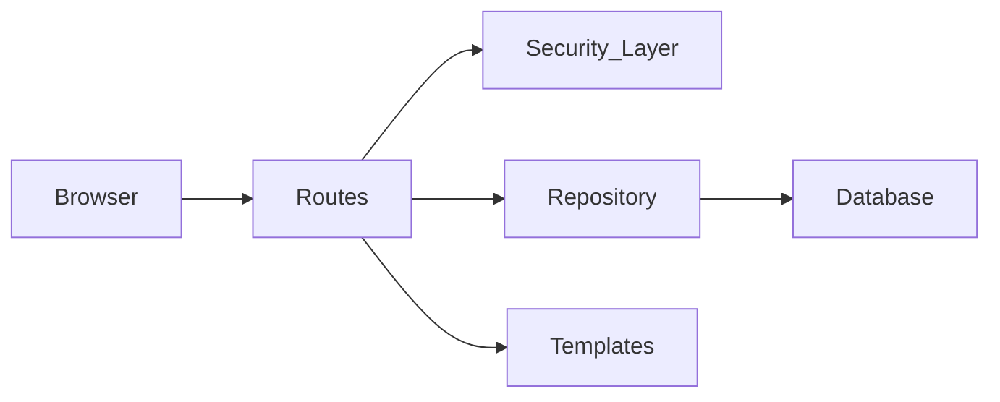

# Project Overview

**SecureLeak** is a simplified bug tracker for vulnerability reports, designed to demonstrate **Defense-in-Depth** and **Secure-by-Design** principles. It is built as a layered Flask application, prioritizing clarity and explicit security controls over framework magic.

---

## 🏗️ Architecture

The application follows a clean separation of concerns:



1.  **Routes (`routes/`)**: Minimal HTTP handlers. They validate input format and delegate logic.
2.  **Security Layer (`security/`)**: Centralized controls for Authentication, Authorization (RBAC), upload/image sanitization, and Audit Logging.
3.  **Repository (`repository/`)**: The *only* place where SQL is executed. Uses parameterized queries to prevent SQL Injection.
4.  **Database (`database/`)**: SQLite with strict schema enforcement.

---

## ⚙️ Core Configuration

The application is configured to be secure by default. Here is the core configuration from `app.py`:

```python
# app.py - Security Configuration
app.config.from_mapping(
    # ...
    SESSION_COOKIE_HTTPONLY=True,
    SESSION_COOKIE_SAMESITE="Lax",
    SESSION_COOKIE_SECURE=not app.debug,
    MAX_CONTENT_LENGTH=3 * 1024 * 1024,
)

# Content Security Policy (CSP) via Flask-Talisman
Talisman(
    app,
    content_security_policy={ 
        "default-src": "'self'", 
        "script-src": "'self'", 
        "style-src": "'self'", 
        "object-src": "'none'", 
        "frame-ancestors": "'none'",
        "form-action": "'self'",
        "base-uri": "'self'"
    },
    force_https=not app.debug,
    strict_transport_security=True
)
```

---

## 🧩 Key Design Choices

### 1. Defense-in-Depth
We don't rely on a single control. For example, to prevent XSS, we use:
*   **Input Validation**: Allowlists (e.g. severity values, image extensions) and length checks (e.g. comment length).
*   **Context-Aware Escaping**: Jinja2 auto-escaping.
*   **Content Security Policy (CSP)**: Browser-level blocking of unauthorized scripts.

### 2. KISS (Keep It Simple, Stupid)
*   **No ORM**: We use raw SQL with parameterized queries. This makes the data access layer transparent and easier to audit for security.
*   **SQLite**: Simple, file-based database that requires no complex setup, perfect for this demonstration.

### 3. Post-Redirect-Get (PRG)
All state-changing actions (POST) redirect to a view (GET) upon success. This prevents double-submission of forms and improves user experience.

---

## 📦 Tech Stack

*   **Framework**: Flask (Python)
*   **Database**: SQLite
*   **Templating**: Jinja2
*   **Security Libraries**:
    *   `Flask-Talisman`: HTTP Headers & CSP.
    *   `Flask-WTF`: CSRF Protection.
    *   `Argon2-cffi`: State-of-the-art password hashing.
    *   `Pillow`: Image processing and sanitization.
    *   `Flask-Limiter`: Rate limiting to prevent brute-force attacks.

---

## Project Structure

```
SecureLeak/
├─ app.py                  # App factory: config, CSRF, security headers, blueprints, error handlers
├─ requirements.txt        # Runtime dependencies (pinned)
├─ requirements-dev.txt    # Runtime + pytest + CI tools, for local development
├─ requirements-ci.txt     # CI lint and security tools (ruff, bandit, pip-audit), pinned
├─ pytest.ini              # pytest configuration
├─ .ruff.toml              # Ruff lint and format rules
├─ README.md               # Project guide + documentation links
├─ LICENSE                 # MIT License
├─ CONTEXT.md              # Domain vocabulary and invariants
├─ AGENTS.md, CLAUDE.md    # Instructions for coding agents
├─ .github/                # CI workflow and Dependabot configuration
├─ docs/                   # Detailed documentation, including adr/ (architecture decision records)
│
├─ database/
│  ├─ connection.py        # get_db()/close_db(); SQLite connection used by repositories
│  ├─ initialize.py        # Applies the schema migration on first run
│  └─ migrations/
│     └─ init.sql          # Schema: tables and indexes
│
├─ repository/             # Data-access layer (parameterized SQL only)
│  ├─ users_repo.py
│  ├─ reports_repo.py
│  └─ comments_repo.py
│
├─ routes/                 # Feature routes (Flask blueprints)
│  ├─ auth.py              # Login, register, logout (Argon2id, CSRF, PRG, Audit)
│  ├─ reports.py           # List/view/new reports, comments, images (Audit, Sanitization)
│  └─ admin.py             # Admin dashboard and status changes
│
├─ security/               # Security helpers and self-made decorators
│  ├─ 10k-common-passwords # List of common passwords for checks
│  ├─ audit.py             # Audit logging logic (writes to instance/audit.log)
│  ├─ auth_utils.py        # Argon2id hasher, email normalize, common password check
│  ├─ decorators.py        # login_required, role checks
│  ├─ limiter.py           # Rate limiting configuration (Flask-Limiter)
│  ├─ reports_access.py    # Shared report visibility policy
│  ├─ security.txt         # Vulnerability disclosure content
│  └─ uploads.py           # Pillow re-encoding and storage of report images
│
├─ seed/                   # Demo data (users.csv, text snippets, images) and seed_runner.py
│
├─ templates/              # Jinja2 templates (auto-escaped)
│  ├─ layout.html          # Base layout + nav + flash messages
│  ├─ ...                  # Feature templates
│  └─ errors/
│     ├─ 400.html          # Bad request (e.g., CSRF)
│     ├─ 404.html          # Not found
│     ├─ 429.html          # Too Many Requests (Rate Limit)
│     └─ 500.html          # Server error
│
├─ static/                 # Front-end assets (CSS, JS, Icons)
│
├─ tests/                  # Pytest test suite
│  ├─ conftest.py          # App fixture (temp DB per test)
│  ├─ auth/                # Login, registration and session lifetime tests
│  ├─ helpers/             # Shared test helpers
│  ├─ reports/             # Report upload tests
│  ├─ repository/          # Repository CRUD tests
│  ├─ security/            # Security headers and SECRET_KEY tests (legacy CSP module is skipped)
│  └─ seed/                # Seed runner tests
│
├─ uploads/                # Uploaded files, created at runtime (kept outside /static, not tracked)
└─ instance/               # Runtime data, created at runtime (not tracked)
   ├─ secureleak.sqlite    # SQLite database
   └─ audit.log            # Security audit log
```

**How it works:**
- `app.py` creates the Flask app, enables CSRF and security headers, registers blueprints, and auto-initializes the SQLite DB on first run.
- `database/` holds the SQLite connection helpers and the migration SQL.
- `repository/` contains small CRUD helpers that use `database.connection.get_db()`.
- `routes/` defines the URL endpoints per feature (auth, reports, admin).
- `templates/` contains the rendered HTML pages, and `static/` serves CSS/JS/icons.
- `instance/` holds the SQLite database and other writable runtime files.
- `uploads/` stores user-uploaded files outside the static path for safety.
